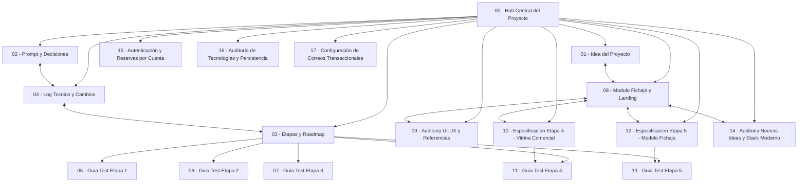

# ⚽ Turnos Canchas & Comunidad Futbolera — Hub Central del Proyecto

> **Bienvenido a la Bóveda de Obsidian del Proyecto.**
> Este documento funciona como el **Nodo Central (Map of Content - MOC)** que unifica, articula y conecta todas las notas, especificaciones, decisiones técnicas, pruebas y auditorías del sistema.

---

## 🗺️ Mapa de Navegación del Grafo de Conocimiento

---

## 1. 🌟 Visión General y Definición de Producto

La plataforma evolucionó desde un simple turnero a una **Plataforma Integral de Fútbol Amateur y Comunidad para Complejos Deportivos**:

- [[01 - Idea del Proyecto]]: Visión global, propuesta de valor y los **3 pilares del negocio**:
  1. **Vitrina Comercial / Publicidad**: Espacio promocional para atraer clientes y mostrar instalaciones (césped, luces LED, vestuarios, quincho/parrillas y buffet).
  2. **Sistema de Reservas (Turnero)**: Motor ágil para reservar turnos en tiempo real con persistencia y sin sobreingeniería.
  3. **Módulo de Fichaje ("Falta Uno")**: Espacio comunitario donde jugadores libres publican su CV deportivo y equipos fichan refuerzos para sus partidos.
- [[02 - Prompt y Decisiones]]: Historial del prompt del usuario, principios fundacionales (*mobile-first*, *cero dependencias*, *cero build step*), directrices operativas y la **política de este chat exclusivo para documentación y consultas**.

---

## 2. 🚀 Nuevas Funcionalidades y Especificación Comunitaria

- [[08 - Modulo Fichaje y Landing - Especificacion y Consultas]]:
  - **Especificación de la Vitrina Comercial**: Hero banner de alta conversión, tarjetas de servicios y valorización del "Tercer Tiempo".
  - **CV Deportivo del Jugador**: Nombre/apodo, WhatsApp, posición (🧤 ARQ, 🛡️ DEF, ⚙️ MED, ⚡ DEL), pierna hábil, nivel, disponibilidad horaria, sede y PIN de 4 dígitos para control.
  - **Mecánica de Fichaje**: Tarjetas visuales coleccionables estilo *Player Cards* y botón directo a WhatsApp con mensaje automático pre-armado.
  - **Pizarra de Avisos Urgentes**: Capitanes con turno confirmado publicando avisos de emergencia (*"Nos falta uno para hoy a las 20hs"*).
  - **Auditoría de Decisiones**: Registro de las respuestas acordadas con el usuario para contacto, privacidad y navegación SPA.

---

## 3. 🎨 Identidad Visual, UI/UX y Sistema de Diseño

- [[09 - Auditoria UI-UX - Frameworks Skills y Referencias]]:
  - **Auditoría de Skills del Entorno**: Selección del tridente clave:
    - `ui-ux-pro-max` (tokens deportivos, reglas de UX, accesibilidad WCAG AA).
    - `impeccable` (refinamiento visual, jerarquía y microinteracciones).
    - `ponytail` (prevención de sobreingeniería y garantía de velocidad).
  - **Evaluación histórica (2026-10-16)**: se prefirió Vanilla CSS/JS por simplicidad. La decisión vigente desde 2026-10-23 es una migración gradual a React 19 + Vite, iniciada por landing/turnero y extendida al panel admin el 2026-10-29.
  - **Benchmarks de Mercado**: Inspiración en *Alquilatucancha (ATC)*, *Playtomic*, *EA Sports FC Player Cards* y complejos deportivos de alto nivel (*Topgolf*).

---

## 4. 📈 Hoja de Ruta Secuencial y Estado de Etapas

El desarrollo avanza bajo el criterio estricto de **etapa probada y auditada al 100% antes de avanzar a la siguiente**:

- [[03 - Etapas y Roadmap]]:
  - **Etapa 1: MVP Base** ✅ *Completada* — 3 archivos base (`index.html`, `style.css`, `app.js`), 4 canchas, localStorage.
  - **Etapa 2: Mejora de Datos y UX** ✅ *Completada* — Migración a `fields.json`, motor `IndexedDB`, validación regex argentina (+54 9), toasts no intrusivos y modales accesibles.
  - **Etapa 3: Panel Admin Básico** ✅ *Completada* — Navegación protegida con clave, CRUD de canchas, bloqueo de horarios por mantenimiento y exportación a CSV.
  - **Etapa 4: Servidor Express y Vitrina Comercial** ✅ *Completada* — Express, landing comercial y reservas.
  - **Etapa 5: Módulo de Fichaje Comunitario** ✅ *Completada* — Catálogo, pizarra, moderación y pruebas entre cuentas confirmadas.
  - **Etapa 6: Notificaciones y Recordatorios** ⏳ *En implementación* — WhatsApp ya disponible; migración y función de correo aplicadas/desplegadas. Falta configurar Resend, Vault y Cron, y probar entregas.
  - **Etapa 7: Pagos y Señas Online** ⏳ *Planificada* — Integración con MercadoPago.

---

## 5. 🧪 Suites de Pruebas y Aseguramiento de Calidad

Cada etapa cuenta con su guía de pruebas, casos Happy Path, casos Edge y métricas de éxito verificadas:

- [[05 - Guia Test Etapa 1]]: 10 casos Happy Path, 6 casos Edge, checklist visual y métricas de carga (<200ms).
- [[06 - Guia Test Etapa 2]]: Validación de IndexedDB, regex de telefonía argentina, toasts, modales y prevención de doble submit.
- [[07 - Guia Test Etapa 3]]: Guía actualizada para el panel administrativo React: autenticación por rol, canchas, bloqueos, reservas/CSV y moderación.
- [[11 - Guia Test Etapa 4]]: Verificación de Vitrina Comercial, Hero, grilla de servicios, botón flotante WhatsApp y acceso unificado Iniciar Sesión.
- [[13 - Guia Test Etapa 5]]: Verificación de Player Cards (FUT Style), carga de CV deportivo, validación de PIN, filtros en vivo y pizarra urgente.

---

## 6. 📜 Auditoría Técnica Continua y Registro de Decisiones

- [[04 - Log Tecnico y Cambios]]: Historial cronológico inmutable de todas las modificaciones arquitectónicas, justificaciones, archivos afectados y resultados de testing, incluyendo la política de este chat como canal exclusivo de documentación y consultas.

---

### 🔗 Enlaces Rápidos a Todas las Notas
- [[00 - Hub Central del Proyecto]]
- [[01 - Idea del Proyecto]]
- [[02 - Prompt y Decisiones]]
- [[03 - Etapas y Roadmap]]
- [[04 - Log Tecnico y Cambios]]
- [[05 - Guia Test Etapa 1]]
- [[06 - Guia Test Etapa 2]]
- [[07 - Guia Test Etapa 3]]
- [[08 - Modulo Fichaje y Landing - Especificacion y Consultas]]
- [[09 - Auditoria UI-UX - Frameworks Skills y Referencias]]
- [[10 - Especificacion Etapa 4 - Vitrina Comercial]]
- [[11 - Guia Test Etapa 4]]
- [[12 - Especificacion Etapa 5 - Modulo Fichaje]]
- [[13 - Guia Test Etapa 5]]
- [[14 - Auditoria de Nuevas Funcionalidades y Migracion a Stack Moderno]]
- [[15 - Autenticacion y Reservas por Cuenta]]
- [[16 - Auditoria de Tecnologias y Persistencia]]
- [[17 - Configuracion de Correos Transaccionales]]
- [[14 - Auditoria de Nuevas Funcionalidades y Migracion a Stack Moderno]]: arquitectura vigente y auditoría del retorno de acceso admin.
