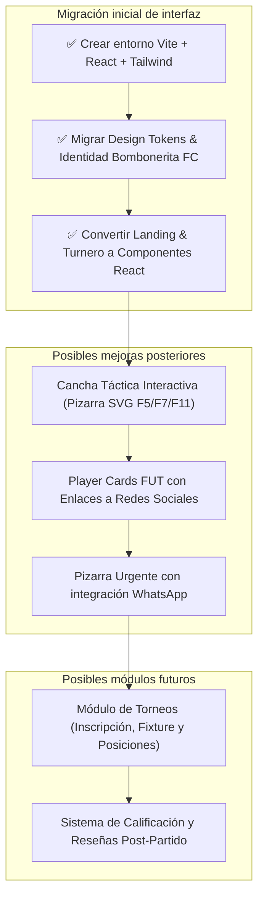

# Auditoría y Especificación: Nuevas Funcionalidades y Migración a Stack Moderno

> **Documento de auditoría técnica, evaluación arquitectónica y plan de evolución tecnológica.**
> Proyecto: "La Bombonerita Fútbol Club" (Salta Capital).
> Enfoque: Transición de prototipo Vanilla a Plataforma Web Moderna, Reactiva y Escalable.

---

## 1. Auditoría de Nuevas Funcionalidades Requeridas

### 1.1. Cancha Táctica Interactiva para Selección de Posición
- **Propósito:** Reemplazar los desplegables estáticos por una representación visual e interactiva de un campo de juego (pizarra de director técnico).
- **Mecánica UX:**
  - Vista cenital de cancha con césped y líneas reglamentarias.
  - Soporte para formatos: **Fútbol 5, Fútbol 7 y Fútbol 11**.
  - Nodos interactivos en posiciones clave:
    - 🧤 **Arquero** (ARQ)
    - 🛡️ **Defensores** (Centrales, Laterales)
    - ⚙️ **Mediocampistas** (Contención, Mixtos, Enganches)
    - ⚡ **Delanteros** (Extremos, Centrodelanteros)
  - Al hacer clic en una posición vacante, el sistema:
    1. Filtra en vivo el catálogo de jugadores que juegan en ese puesto.
    2. O pre-completa el aviso de urgencia ("Nos falta arquero").
- **Implementación Técnica:** Componente SVG responsivo con pines interactivos animados (`Framer Motion` o CSS Transitions nativas).

---

### 1.2. Sistema de Reseñas y Reputación con Validación Real
- **Problema Detectado:** Comentarios anónimos o abiertos fomentan spam, burlas, calificaciones entre amigos o ataques tóxicos.
- **Mecanismo de "Validación Real" (Anti-Fraude):**
  1. **Vínculo con Turno/Partido Confirmado:** Solo un usuario (capitán o jugador) que haya compartido una reserva confirmada o aviso urgente completado en el predio tiene derecho a calificar.
  2. **Dimensiones de Reputación Estructuradas:**
     - ⏱️ **Puntualidad y Asistencia** (¿Llegó a horario? ¿Avisó a tiempo?).
     - 🤝 **Fair Play & Convivencia** (Trato deportivo y buena onda).
     - ⚽ **Habilidad Percibida** (Calificación orientativa 1 a 5 estrellas).
  3. **Insignia "Jugador Confiable":** Reconocimiento automático para perfiles con 100% de asistencia verificada en sus últimos 5 partidos.
  4. **Moderación de Comentarios:** Filtro de lenguaje inapropiado y derecho a réplica/reporte desde el panel de administración.

---

### 1.3. Integración de Redes Sociales en el CV Deportivo
- **Campos Agregados al Perfil:**
  - Instagram: `@usuario` (genera enlace `https://instagram.com/usuario`).
  - TikTok: `@usuario` (enlace a videos de jugadas / partidos).
  - Enlace de contacto rápido complementario.
- **Valor Agregado:** Humaniza el perfil, permite verificar identidad real y le da visibilidad al deportista amateur dentro de la comunidad de Salta.

---

### 1.4. Módulo Integral de Organización de Torneos
- **Impacto de Negocio:**
  - Maximiza la ocupación de canchas en días hábiles (lunes a jueves de noche).
  - Incrementa la facturación por inscripciones y consumo en buffet/quinchos.
- **Módulos del Sistema de Torneos:**
  1. **Inscripción de Equipos:** Formulario de alta de club/equipo con lista de buena fe (capitán, jugadores, dorsales).
  2. **Generador de Fixtures:**
     - Fase de Grupos (todos contra todos / round-robin).
     - Playoffs / Eliminación directa (octavos, cuartos, semifinal y final).
  3. **Tabla de Posiciones Dinámica:** Cálculo automático de Puntos (PTS), Partidos Jugados (PJ), Ganados (PG), Empatados (PE), Perdidos (PP), Goles a Favor (GF), Goles en Contra (GC) y Diferencia de Gol (DG).
  4. **Estadísticas de Torneo:** Goleadores, tarjetas amarillas/rojas y sanciones disciplinarias.

---

## 2. Diagnóstico de Arquitectura: ¿Por qué migrar de Vanilla JS?

El stack inicial (Vanilla HTML/CSS/JS + IndexedDB) cumplió con creces el objetivo del MVP y la vitrina comercial. Sin embargo, para la siguiente etapa presenta limitaciones insalvables:

| Reto | Vanilla JS + IndexedDB | Stack Moderno Reactivo |
|---|---|---|
| **Pizarra Táctica Interactiva** | Manipulación imperativa y compleja del DOM. | Estado reactivo declarativo: el clic en el pin del SVG actualiza los filtros al instante. |
| **Tablas y Llaves de Torneo** | Cientos de líneas de código manual para recalcular tablas y cruces. | Componentes modulares y librerías especializadas de torneos (`react-tournament-brackets`). |
| **Comunidad y Reseñas Reales** | IndexedDB es local a un solo navegador (no permite compartir reseñas entre usuarios). | Base de datos centralizada en tiempo real (PostgreSQL / Supabase). |
| **Mantenibilidad** | Archivo `app.js` monotélico de >2000 líneas ("código espagueti"). | Arquitectura de componentes limpios y reutilizables (`/components`, `/hooks`, `/pages`). |

---

## 3. Arquitectura vigente y evolución posible

Esta auditoría se redactó como una evolución futura. El 2026-10-23 se decidió iniciar la migración de forma gradual, conservando Express, Supabase, los datos y las políticas RLS existentes. Al 2026-10-29, React gestiona landing, reservas y panel administrativo; `/v1` conserva Fichajes público y sirve como respaldo temporal.

### 3.1. Frontend en transición: **React 19 + Vite + Tailwind + Express**
- `frontend/` aloja el nuevo cliente React; Vite compila a `frontend/dist` y Express lo sirve cuando la build está disponible.
- Landing, catálogo de canchas, reservas de clientes, acceso a cuenta e historial se migran primero.
- Supabase Auth y PostgreSQL siguen siendo la fuente compartida; la migración no cambia tablas, claves ni políticas RLS.
- La versión Vanilla vive en `public/` y queda accesible por `/v1`; `/fichajes` y su experiencia pública siguen usando esa página durante esta fase.
- `shadcn/ui` y Lucide se mantienen como opciones futuras, no son dependencias de esta primera migración.

### 3.2. Backend & Base de Datos: **Node.js (Express) + Supabase (PostgreSQL)**
- **Supabase (PostgreSQL):**
  - Autenticación segura para capitanes, jugadores y administrador.
  - Base de datos relacional para vincular:
    `Usuarios` -> `Reservas` -> `Reseñas` -> `Equipos` -> `Partidos de Torneo`.
  - Capa gratuita generosa, excelente para proyectos deportivos locales.

---

## 4. Migración progresiva del frontend

La secuencia de migración de interfaz ya está iniciada. Los módulos posteriores siguen siendo opciones y no sustituyen el roadmap comercial; ver [[03 - Etapas y Roadmap]].

### Estado de migración — 2026-10-29
- [x] Entorno inicial en `frontend/` con React 19, Vite y Tailwind CSS 4.
- [x] Tokens deportivos aplicados al cliente React.
- [x] Landing y turnero en componentes React; registro, inicio y recuperación de contraseña usan Supabase Auth.
- [x] Reservas e historial conectados a las tablas compartidas actuales, sin cambios de esquema.
- [x] Express sirve la build React y conserva la versión anterior en `/v1`.
- [x] Migrar administración a React: resumen, reservas/CSV, canchas, bloqueos y moderación de Fichajes.
- [x] Migrar Fichajes público a React en una etapa separada.
- [ ] Revisar visualmente y probar en móvil/desktop los flujos con Supabase y roles reales.

### Auditoría del retorno de acceso admin — 2026-10-29
- La URL observada `/login?redirectTo=%2Fv1%2F#admin` no era una ruta de login implementada. El fallback de Express entregaba React, pero el cliente no interpretaba `redirectTo` ni `#admin` en esa ruta.
- React enviaba a los administradores a `/v1/#admin`, dividiendo un solo inicio de sesión entre dos aplicaciones.
- El sitio Vanilla dependía del CDN jsDelivr para definir `window.supabase`; el frontend React ya usa el paquete npm local. Una falla del CDN en `/v1` podía romper la inicialización de la sesión al entrar al panel.
- La hidratación React llamaba `getSession()` y también se suscribía a `onAuthStateChange`; ambas rutas podían consultar perfil y disparar la navegación al detectar rol admin.
- La consulta del perfil no comprobaba su error, por lo que un fallo de RLS o una fila ausente podía parecer una cuenta cliente.
- Corrección aplicada: el panel se migró a React; `/login` y `#admin` abren el acceso de React; el rol se hidrata desde el evento inicial de Supabase y el administrador se queda en React. Los errores de perfil ahora se muestran. No se alteró el esquema ni RLS.
- Las entradas antiguas `/v1/#admin` también se redirigen al panel React; `/v1` queda para la versión Vanilla de Fichajes y respaldo.
- Pendiente de validación manual: inicio con cuenta admin/cliente, CRUD de canchas y bloqueos, cancelación/exportación de reservas y moderación con migración 003 aplicada.

### Estado de migración de Fichajes público — 2026-10-30
- Catálogo, filtros, perfiles, reportes y avisos urgentes ahora se renderizan desde React en `frontend/src/Fichajes.jsx`.
- Express y Vite sirven la app React en `/fichajes`; `/v1/fichajes.html` se mantiene como respaldo Vanilla.
- La build se verificó con `npm run build`. Quedan pendientes las pruebas manuales multiusuario de `Docs/13`.

---
**Navegación del Grafo:**
- 🏠 Hub Principal: [[00 - Hub Central del Proyecto]]
- 🚀 Hoja de Ruta: [[03 - Etapas y Roadmap]]
- 📋 Vitrina Comercial: [[10 - Especificacion Etapa 4 - Vitrina Comercial]]
- 📋 Fichajes Base: [[12 - Especificacion Etapa 5 - Modulo Fichaje]]
- 📜 Registro Técnico: [[04 - Log Tecnico y Cambios]]

